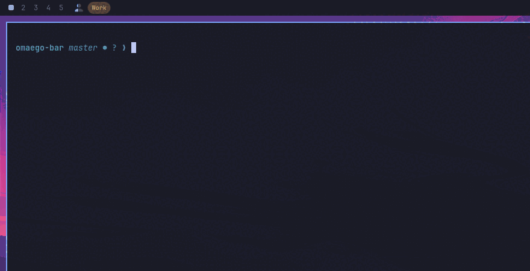

# omaego bar widget

> Powered by the [omaego](https://github.com/lcorneliussen/omaego) CLI.

Shows which **ego** — which browser identity — owns the workspace you are on,
and opens a panel to act on all of them.



The label names the egos with a browser window on the current workspace, in the
order their tiles appear. Clicking opens the panel: one **ego card** per ego,
faded when that ego has nothing here, each carrying its colour, its web apps,
and the actions that apply to it on this workspace. While the panel is open,
every ego's windows are outlined in that ego's colour, so the mapping between a
name and the tiles on screen is readable at a glance.

From a card you can launch the ego or one of its web apps here, add a web app
(`+app`), edit or remove one (hover it for ✎ and ✕), or close everything that
ego has open on this workspace (`✕`). Under **Remote**, a card lists the herdr
sessions, TUIs and agent gateways on your machines that are pinned to that ego,
each tagged with its machine ("here" when it is this one), and **Add session
or gateway** offers what your online machines have. They open where they run,
or over ssh, and reconnect by themselves. Drag a card by its name, or an app
or remote row, to rearrange them; the order is kept in your egos repo, so
every device shows the same. Below the cards are the routing rules, with add
and delete.

The **Sync** row at the bottom keeps your egos, web apps and rules in a private
git repo. Until there is one, it offers to set one up. After that, it shows how
the repo and this machine differ, and one click syncs them. The default agent
writes the commits and resolves conflicts. An ego from the repo that this
machine does not have yet appears as a faded card with **Set up here**. Web apps
the repo declares that this machine has not installed yet show blurred, and the
first click installs one.

Each card names the browser its ego runs in. Click that row to move the ego to
another installed browser and choose what it should hold there: its own
profile, a copy of one that browser already has, or an empty one.

## Requires

This widget is a front end for the **omaego** CLI, which does the actual
routing. Install it first:

```bash
# Arch / Omarchy — pinned to a released tarball
git clone https://github.com/lcorneliussen/omaego
cd omaego/packaging && makepkg -si
omaego setup
```

Without it the widget loads and shows nothing, since it has no egos to report.

## Install

```bash
omarchy plugin add https://github.com/lcorneliussen/omaego-bar.git --enable
omarchy restart shell
```

The restart matters: a hot reload will not instantiate the widget in a new bar
section, and it simply will not appear, with nothing in the logs to say so.

Place it where you like with `omarchy bar move io.github.lcorneliussen.omaego
--section left`; it is designed to sit just after the workspaces.

## Remove

```bash
omarchy plugin remove io.github.lcorneliussen.omaego
omarchy restart shell
```

## Settings

| key | default | meaning |
|---|---|---|
| `command` | `omaego` | path to the CLI |
| `pollSeconds` | `3` | refresh interval; workspace changes refresh instantly |
| `hideWhenEmpty` | `false` | hide the widget on workspaces with no ego |
| `iconFont` | `JetBrainsMono Nerd Font` | font the split-person mark is drawn from |

## External dependencies

`omaego` (this widget shells out to it), and through it `python`, `hyprctl`,
and optionally `walker` for naming an ego or a rule. The widget itself runs no
network code: the panel comes from `omaego panel`, the add-app picker from
`omaego app catalog` and `omaego app probe`, and the only files it reads are the
icons those commands point at.

MIT licensed.

## Regenerating the screenshots

`scripts/demo.sh` rebuilds `preview.png` and `demo.gif` by driving a contained
Omarchy desktop ([omabox](https://github.com/omacom-io/omabox)) seeded with
invented egos, so a published asset can never contain a real identity, customer
or account. Rerun it after a UI change:

```bash
OMAEGO_SRC=~/Work/omaego scripts/demo.sh
```
